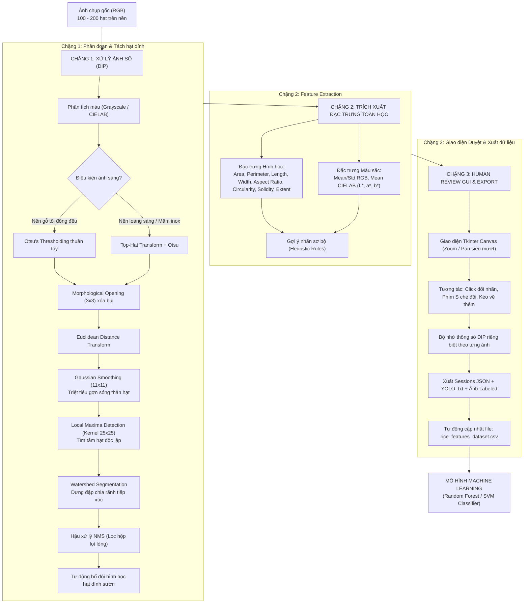

# 🌾 Automated Rice Grain Counting & Quality Assessment
> **Hệ thống Gán nhãn Bán tự động (Semi-Automatic Labeling System)**  
> *Sử dụng Xử lý ảnh số thuần túy (Pure Digital Image Processing) kết hợp Trích xuất đặc trưng Hình học/Màu sắc & Giao diện tương tác Human-in-the-Loop.*

---

## 📑 Mục lục
1. [Bối cảnh & Mục tiêu Đề tài](#1-bối-cảnh--mục-tiêu-đề-tài)
2. [Kiến trúc Tổng thể Hệ thống (Architecture Diagram)](#2-kiến-trúc-tổng-thể-hệ-thống)
3. [Chi tiết Thuật toán Từng Bước (Core Algorithms & Mathematics)](#3-chi-tiết-thuật-toán-từng-bước)
   - [Bước 1: Tiền xử lý & Phân đoạn nhị phân (Top-Hat vs. Otsu)](#bước-1-tiền-xử-lý--phân-đoạn-nhị-phân-top-hat-vs-otsu)
   - [Bước 2: Tách hạt dính nhau (Distance Transform + Watershed)](#bước-2-tách-hạt-dính-nhau-distance-transform--watershed)
   - [Bước 3: Lọc hộp rác lọt lòng (Non-Maximum Suppression) & Bổ đôi hình học](#bước-3-lọc-hộp-rác-lọt-lòng-non-maximum-suppression--bổ-đôi-hình-học)
   - [Bước 4: Trích xuất Vector đặc trưng (Feature Extraction: Shape & Color)](#bước-4-trích-xuất-vector-đặc-trưng-feature-extraction-shape--color)
   - [Bước 5: Giao diện duyệt nhãn & Cách ly tham số từng ảnh (Human Review GUI)](#bước-5-giao-diện-duyệt-nhãn--cách-ly-tham-số-từng-ảnh-human-review-gui)
4. [Cấu trúc Thư mục Dự án](#4-cấu-trúc-thư-mục-dự-án)
5. [Hướng dẫn Cài đặt & Chạy Thực nghiệm Từng Bước](#5-hướng-dẫn-cài-đặt--chạy-thực-nghiệm-từng-bước)
   - [5.1. Chạy các file thực nghiệm từng bước (Step 1 -> Step 3)](#51-chạy-các-file-thực-nghiệm-từng-bước-step-1---step-3)
   - [5.2. Chạy ứng dụng giao diện hoàn chỉnh (Semi-Auto GUI)](#52-chạy-ứng-dụng-giao-diện-hoàn-chỉnh-semi-auto-gui)
6. [Cẩm nang Sử dụng Giao diện & Bảng Phím tắt Nhanh](#6-cẩm-nang-sử-dụng-giao-diện--bảng-phím-tắt-nhanh)
7. [Đặc tả Dữ liệu Đầu ra (Output Dataset Specification)](#7-đặc-tả-dữ-liệu-đầu-ra-output-dataset-specification)
8. [Kế hoạch Phát triển Tương lai (Roadmap)](#8-kế-hoạch-phát-triển-tương-lai-roadmap)

---

## 1. Bối cảnh & Mục tiêu Đề tài

### 1.1. Vấn đề thực tế
* Trong sản xuất nông nghiệp và thương mại lúa gạo, việc đếm số lượng hạt và đánh giá tỷ lệ gạo nguyên/gạo gãy (gạo tấm) thủ công bằng mắt thường rất tốn thời gian, dễ gây sai số và mỏi mắt khi mẫu ảnh có từ **100 đến 200 hạt**.
* Mạng nơ-ron học sâu (như YOLO) có thể phát hiện tốt nhưng đóng vai trò như một **"hộp đen (black box)"**, không áp dụng được các kiến thức toán học và nguyên lý biến đổi hình thái cốt lõi của môn học **Xử lý ảnh số (Digital Image Processing - DIP)**.
* **Mục tiêu của đề tài**: Xây dựng một luồng xử lý ảnh kết hợp giữa **Xử lý ảnh kinh điển** và **Học máy (Machine Learning: Random Forest, SVM)** có tính giải thích cao (Explainable AI), giải quyết triệt để bài toán hạt gạo nằm ép sát / chồng lấn nhau (*touching/overlapping grains*).

### 1.2. Mục tiêu của Module Semi-Automatic Labeling
* Thay vì phải tự vẽ tay hàng chục nghìn bounding box trên 170+ ảnh thô (mất hàng tuần), công cụ này:
  1. **Tự động hóa 85% - 90%**: Tự phát hiện hạt, tách hạt dính, tính kích thước và vẽ hộp gợi ý nhãn sơ bộ.
  2. **Con người kiểm tra 10% - 15% (Human-in-the-loop)**: Giao diện GUI cho phép người dùng click đổi nhãn, vẽ thêm hoặc chẻ đôi hạt dính trong vài giây.
  3. **Xuất bộ Dataset chuẩn**: Tạo ra file `rice_features_dataset.csv` chứa 25 trường đặc trưng hình học + màu sắc làm dữ liệu đầu vào cho bước huấn luyện mô hình Machine Learning.

---

## 2. Kiến trúc Tổng thể Hệ thống



---

## 3. Chi tiết Thuật toán Từng Bước

### Bước 1: Tiền xử lý & Phân đoạn nhị phân (Top-Hat vs. Otsu)
* **Thử thách**: Mặt bàn gỗ có vân sẫm-sáng và ánh sáng đèn rọi không đồng đều.
* **White Top-Hat Transform**:
  $$T_{\text{hat}}(f) = f - (f \circ b)$$
  * $f$: Ảnh xám gốc.
  * $b$: Kernel elip kích thước lớn hơn bề ngang hạt gạo ($41 \times 41$).
  * Phép Opening ($f \circ b$) xóa mất các vật thể nhỏ (hạt gạo), chỉ giữ lại nền trơn. Lấy ảnh gốc trừ ảnh nền sẽ triệt tiêu nền gỗ về $0$, chỉ giữ lại hạt gạo sáng.
* **Otsu Thresholding**:
  * Tự động tìm ngưỡng $T$ tối đa hóa phương sai giữa 2 lớp (inter-class variance $\sigma_B^2$):
    $$\sigma_B^2(T) = \omega_0(T)\omega_1(T)[\mu_0(T) - \mu_1(T)]^2$$
  * *Thực nghiệm cho thấy*: Khi chụp trên nền bàn gỗ sẫm màu có độ tương phản tự nhiên cao, **Otsu thuần túy trực tiếp trên ảnh xám** cho thân hạt gạo dày dặn và đầy đủ hơn Top-Hat. Do đó, hệ thống mặc định dùng Otsu thuần và cung cấp nút bật Top-Hat linh hoạt cho từng ảnh khi cần.

---

### Bước 2: Tách hạt dính nhau (Distance Transform + Watershed)
* **Thử thách "Chí mạng"**: 2-3 hạt gạo nằm sát nhau tạo thành 1 đốm trắng khổng lồ.
* **Euclidean Distance Transform ($D_L2$)**:
  * Đo khoảng cách từ mỗi pixel trắng tới pixel đen (nền) gần nhất. Càng vào giữa thân hạt, giá trị càng cao (tạo thành đỉnh núi - Peak).
* **Khắc phục lỗi "Băm vụn hạt gạo" (Over-segmentation)**:
  * Thân hạt gạo gồ ghề có thể tạo nhiều đỉnh phụ $\to$ Dùng `cv2.GaussianBlur(dist, (11, 11), 0)` để làm phẳng bề mặt.
  * Dùng phép toán hình thái Dilate với kernel elip $(25 \times 25)$ để tìm **Local Maxima**:
    $$\text{Peak} = (D_{\text{smooth}} == \text{Dilate}(D_{\text{smooth}}, K_{25})) \ \& \ (D_{\text{smooth}} > 4.0)$$
* **Thuật toán Phân thủy (Watershed Segmentation)**:
  * Xem ảnh như bản đồ địa hình, rót nước dâng lên từ các đỉnh Local Maxima. Khi dòng nước từ 2 hạt gặp nhau $\to$ Dựng đập ranh giới phân tách (marker = $-1$).

---

### Bước 3: Lọc hộp rác lọt lòng (Non-Maximum Suppression) & Bổ đôi hình học

#### 1. Bộ lọc NMS (Lọc hộp lọt lòng)
* Khi hạt gạo quá dài, ở mép hạt có thể sót lại 1 đỉnh phụ nhỏ $\to$ Sinh ra một chiếc hộp Đỏ bé tí nằm lọt thỏm trong hộp Xanh lớn.
* Thuật toán tự tính tỷ lệ giao nhau:
  $$\text{Overlap Ratio} = \frac{\text{Area}(B_1 \cap B_2)}{\text{Area}(B_2)}$$
  Nếu $\text{Overlap Ratio} > 0.5$ và $\text{Area}(B_1) > \text{Area}(B_2) \to$ **Loại bỏ hộp $B_2$**.

#### 2. Tự động chẻ đôi hạt dính mạn sườn (Geometry Splitting)
* Hai hạt gạo nằm ép sát mạn sườn có:
  $$\text{Width} \ge 26.0\text{ px}, \quad \text{Area} \ge 1000\text{ px}, \quad \text{Aspect Ratio} < 2.1$$
* Thuật toán tự động tính góc nghiêng $\theta$ của trục ngắn và dịch chuyển tâm sang 2 bên một đoạn $\frac{\text{Width}}{4}$, bổ đôi thành **2 chiếc hộp Xanh lá độc lập**.

---

### Bước 4: Trích xuất Vector đặc trưng (Feature Extraction: Shape & Color)
Cho mỗi hạt gạo, trích xuất 20 đặc trưng số phục vụ Machine Learning:

| Nhóm đặc trưng | Tên trường (CSV) | Ý nghĩa toán học / Ứng dụng phân loại |
| :--- | :--- | :--- |
| **Kích thước** | `area`, `perimeter` | Diện tích pixel & Chu vi viền (hạt gãy có diện tích nhỏ hơn hẳn). |
| **Hình học chính** | `length`, `width` | Chiều dài (trục lớn) và Chiều rộng (trục bé) từ Rotated Rect. |
| **Tỷ lệ thuôn** | `aspect_ratio` | $\text{Length} / \text{Width}$. Gạo chuẩn $> 2.2$; gạo gãy/tròn $< 1.8$. |
| **Độ tròn** | `circularity` | $4\pi \cdot \text{Area} / \text{Perimeter}^2$ (Hình tròn = 1.0, gạo thon dài ~ 0.45 - 0.65). |
| **Độ đặc** | `solidity` | $\text{Area} / \text{Convex Hull Area}$ (Phát hiện hạt bị mẻ góc khuyết). |
| **Lấp đầy** | `extent` | $\text{Area} / (\text{Length} \times \text{Width})$. |
| **Màu sắc RGB** | `mean_r/g/b`, `std_r/g/b` | Cường độ màu trung bình & độ lệch chuẩn trên thân hạt. |
| **Màu sắc LAB** | `mean_L`, `mean_a`, `mean_b_lab` | Không gian màu CIELAB ($b^*$ dương cao $\to$ Hạt bị ố vàng, thâm mốc). |

---

### Bước 5: Giao diện duyệt nhãn & Cách ly tham số từng ảnh (Human Review GUI)
* **Kiến trúc Per-Image DIP Isolation**: Mỗi bức ảnh trong thư mục có thể có điều kiện ánh sáng, độ tương phản khác nhau. Khi người dùng kéo thanh trượt (Top-Hat, Bù ngưỡng Otsu, Peak Kernel) $\to$ **Thông số đó chỉ lưu và áp dụng cho duy nhất bức ảnh đó**. Khi chuyển sang ảnh khác, hệ thống tự động trả về thông số mặc định.
* **Cơ chế lưu Session JSON**: Mỗi ảnh được lưu trạng thái riêng trong `labeled_dataset/sessions/<tên_ảnh>.json`, cho phép tắt app mở lại bất kỳ lúc nào mà không bị mất tiến độ.

---

## 4. Cấu trúc Thư mục Dự án

```text
F:\AAA\Image\Project/
│
├── semi_auto_labeler/                     # Thư mục mã nguồn chính của ứng dụng
│   ├── dip_engine.py                      # Bộ não xử lý ảnh thuần túy & trích xuất đặc trưng
│   ├── rice_labeler_gui.py                # Ứng dụng giao diện Tkinter tương tác người dùng
│   └── run_labeler.py                     # File khởi chạy nhanh (bên trong package)
│
├── run_labeler.py                         # File khởi chạy nhanh ngoài root: python run_labeler.py
│
├── test_step1_tophat.py                   # Thực nghiệm Bước 1: So sánh Top-Hat vs Direct Otsu
├── test_step2_watershed.py                # Thực nghiệm Bước 2: Tách hạt dính bằng Watershed
├── test_step2_v2.py                       # Thực nghiệm Bước 2 bản V2: Otsu thuần túy
├── test_step3_fetures_boxes.py            # Thực nghiệm Bước 3: Trích xuất đặc trưng & vẽ box
├── test_step3_fetures_boxes_V2.py         # Thực nghiệm Bước 3 bản V2: Bổ đôi hình học
├── test_step3_fetures_boxes_V3.py         # Thực nghiệm Bước 3 bản V3: Tích hợp lọc NMS
│
├── Rice thay nhu 3 - auto label.v1i.yolov11/ # Thư mục ảnh chụp gốc (170 ảnh mẫu)
│   └── train/images/*.jpg
│
├── labeled_dataset/                       # KẾT QUẢ ĐẦU RA CHO CẢ NHÓM (Auto-generated)
│   ├── rice_features_dataset.csv          # File CSV 25 cột đặc trưng để train Machine Learning
│   ├── sessions/*.json                    # Lưu phiên làm việc & thông số riêng từng ảnh
│   ├── visualized/*_labeled.jpg           # Ảnh trực quan hóa box Xanh/Đỏ & bảng tỷ lệ %
│   └── yolo_labels/*.txt                  # File tọa độ nhãn YOLO chuẩn hóa
│
├── .gitignore                             # Tự động loại trừ file zip nặng, cache, temp
└── README.md                              # Tài liệu hướng dẫn toàn diện này
```

---

## 5. Hướng dẫn Cài đặt & Chạy Thực nghiệm Từng Bước

### Yêu cầu Tiền đề
* Hệ điều hành: Windows / Linux / macOS.
* Python: Phiên bản 3.9 trở lên.
* Cài đặt các thư viện phụ thuộc:
```powershell
pip install opencv-python numpy scipy pillow
```

---

### 5.1. Chạy các file thực nghiệm từng bước (Step 1 -> Step 3)
Nếu bạn muốn tái hiện lại quá trình nghiên cứu hoặc chạy minh họa kết quả cho thầy xem:

* **Bước 1: Kiểm tra phép biến đổi Top-Hat**:
  ```powershell
  python test_step1_tophat.py
  ```
  *Kết quả xuất tại:* `step1_results/` (xem ảnh `4_tophat_otsu_success.jpg`).

* **Bước 2: Kiểm tra thuật toán Watershed tách hạt dính**:
  ```powershell
  python test_step2_watershed.py
  ```
  *Kết quả xuất tại:* `step2_results/` (xem đường ranh giới đỏ trên `3_watershed_split.jpg`).

* **Bước 3: Kiểm tra đo đạc kích thước & lọc NMS hộp lọt lòng**:
  ```powershell
  python test_step3_fetures_boxes_V3.py
  ```
  *Kết quả xuất tại:* `step3_results/` (xem ảnh `bounding_boxes_v3_clean.jpg`).

---

### 5.2. Chạy ứng dụng giao diện hoàn chỉnh (Semi-Auto GUI)

Tại thư mục gốc `F:\AAA\Image\Project`, mở PowerShell hoặc CMD và chạy:
```powershell
python run_labeler.py
```

Ứng dụng sẽ tự động tải bộ 170 ảnh, nạp bức ảnh đầu tiên và chạy Auto-Detect hiển thị ngay lên màn hình.

---

## 6. Cẩm nang Sử dụng Giao diện & Bảng Phím tắt Nhanh

### 6.1. Quy trình gán nhãn 3 bước "siêu tốc" (Tiết kiệm >80% thời gian)
1. **Bước 1 (Xem máy tự vẽ)**: Ảnh mở lên đã được thuật toán DIP đóng khung và gợi ý sẵn Xanh (Normal) / Đỏ (Defective).
2. **Bước 2 (Chỉnh nhanh bằng phím tắt)**:
   * Nếu là **ảnh toàn gạo chuẩn**: Bấm phím **`1`** (toàn bộ hạt lập tức thành màu Xanh).
   * Nếu là **ảnh toàn gạo gãy/tấm**: Bấm phím **`2`** (toàn bộ hạt lập tức thành màu Đỏ).
   * Nếu có cặp hạt dính sườn: Bấm phím **`S`** rồi click vào hộp đó để chẻ đôi.
   * Nếu máy đoán nhầm 1-2 hạt: Click chuột trái vào hạt đó để đổi nhãn (`Q`).
   * Nếu ảnh bị tối/mờ quá: Kéo thanh trượt `Bù ngưỡng Otsu (+/-)` bên phải rồi bấm `R`.
3. **Bước 3 (Lưu & Sang ảnh tiếp)**:
   * Nhấn phím **`Enter`** $\to$ Hệ thống tự động lưu file ảnh, file json, file yolo txt, tự cập nhật file CSV tổng hợp và tự nhảy sang ảnh kế tiếp!

### 6.2. Bảng Phím tắt Toàn diện

| Phím tắt | Thao tác tương ứng | Mô tả chức năng |
| :---: | :---: | :--- |
| **Con lăn chuột** | Zoom In / Out | Phóng to / Thu nhỏ mượt mà ngay tại vị trí trỏ chuột. |
| **Space + Kéo chuột** | Pan Image | Giữ phím cách và kéo chuột trái để di chuyển vùng nhìn. |
| **`Q`** | Chế độ Toggle | Click chuột trái vào hạt để đổi nhanh **Normal (Xanh) ↔ Defective (Đỏ)**. |
| **Click phải** *(hoặc `X`)* | Delete Box | Xóa nhanh hộp rác do vết bẩn trên mặt bàn. |
| **`W`** | Chế độ Draw | Kéo chuột trái trên vùng trống để vẽ thêm hộp bao cho hạt bị sót. |
| **`S`** | Split Width | Click vào một hộp để **chẻ đôi theo mạn sườn** (2 hạt song song). |
| **`E`** | Split Length | Click vào một hộp để **chẻ đôi theo chiều dọc** (2 hạt nối đầu-đuôi). |
| **`1`** | Bulk Normal | Đặt nhanh toàn bộ hạt trên ảnh hiện tại thành **Normal**. |
| **`2`** | Bulk Defective | Đặt nhanh toàn bộ hạt trên ảnh hiện tại thành **Defective**. |
| **`R`** | Re-run DIP | Chạy lại Auto-Detect riêng cho ảnh này sau khi chỉnh thanh trượt. |
| **`V`** | View 4 Steps | Mở cửa sổ popup xem 4 ảnh trung gian: Gray, Otsu, Distance Map, Watershed. |
| **`F`** | Fit Screen | Thu phóng ảnh vừa vặn với kích thước cửa sổ Canvas. |
| **`Ctrl + Z`** | Undo | Hoàn tác lại thao tác chỉnh sửa vừa thực hiện. |
| **`Enter`** | Save & Next | Lưu ảnh hiện tại $\to$ Cập nhật CSV $\to$ Tự động mở ảnh tiếp theo. |
| **`A` / `D`** | Prev / Next | Chuyển tới ảnh phía trước / phía sau. |

---

## 7. Đặc tả Dữ liệu Đầu ra (Output Dataset Specification)

Sau khi duyệt ảnh, file **`labeled_dataset/rice_features_dataset.csv`** sẽ tự động được tích lũy. Cấu trúc gồm 25 cột chuẩn hóa:

```csv
image_name,grain_id,label_name,label_id,source,cx,cy,length,width,angle,area,perimeter,aspect_ratio,circularity,solidity,extent,mean_r,mean_g,mean_b,std_r,std_g,std_b,mean_L,mean_a,mean_b_lab
IMG_0485_MOV-0002.jpg,1,Normal,0,auto,862.93,740.81,64.72,22.60,-60.50,708.00,165.20,2.864,0.482,0.912,0.484,218.45,210.12,198.30,16.20,18.40,19.10,215.30,127.80,134.20
...
```

* `label_id`: `0` = Normal (Gạo chuẩn), `1` = Defective (Gạo gãy, vỡ, đổi màu).
* `source`: Nguồn gốc hạt (`auto` = máy tự tìm, `auto_split` = máy tự bổ đôi, `manual_draw` = người dùng vẽ thêm, `manual_split` = người dùng dùng phím S chẻ đôi).

---

## 8. Kế hoạch Phát triển Tương lai (Roadmap)

- [x] **Tuần 10 - 11**: Xây dựng hoàn thiện lõi Xử lý ảnh (DIP) + NMS + Bổ đôi hạt dính + Tkinter GUI Semi-Auto Labeler.
- [ ] **Tuần 12 - 13**: Duyệt toàn bộ 170 ảnh qua GUI để xuất file `rice_features_dataset.csv` hoàn chỉnh (ước tính 15.000 - 20.000 mẫu hạt gạo).
- [ ] **Tuần 13 - 14**: Huấn luyện các mô hình Machine Learning cổ điển (**Random Forest**, **SVM (RBF Kernel)**, **k-NN**) trên bảng đặc trưng CSV. So sánh độ chính xác (Accuracy, F1-Score, Confusion Matrix).
- [ ] **Tuần 15 - 16**: Tích hợp mô hình ML đã train trở lại vào ứng dụng: Đưa 1 ảnh mới bất kỳ vào $\to$ Hệ thống tự động đếm số lượng $\to$ Tự phân loại $\to$ Xuất báo cáo tỷ lệ chất lượng:
  $$\text{Normal Ratio (\%)} = \frac{N_{\text{normal}}}{N_{\text{total}}} \times 100\%$$
- [ ] **Tuần 17**: Hoàn thiện Slide báo cáo và bảo vệ đồ án kết thúc môn học.
